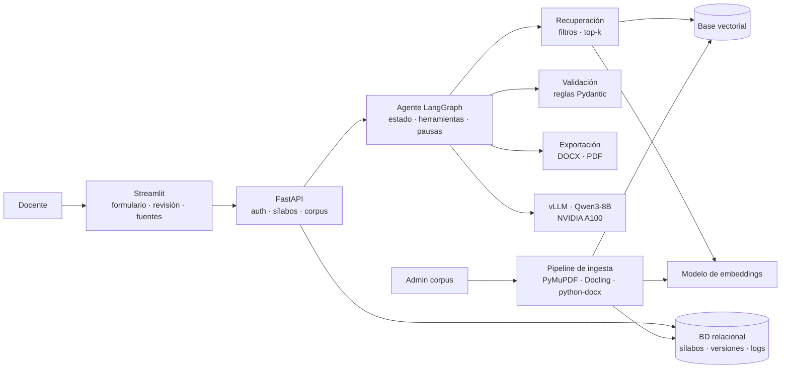
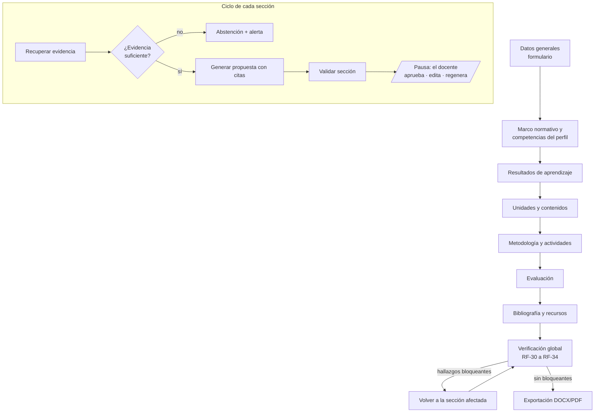

# SyllabusAI — Especificación del proyecto

**Agente inteligente basado en RAG para la creación asistida de sílabos en formato institucional**

| | |
|---|---|
| Código institucional | ITI-TFG-B26-0018 |
| Institución | Universidad Tecnológica Indoamérica · Facultad de Ingenierías |
| Carrera | ITI · Ingeniería en Tecnologías de la Información |
| Modalidad del TFG | Desarrollo de un trabajo de integración curricular |
| Período y sede | B26 · Quito |
| Docente proponente | Andrès Xavier Rubio Proaño |
| Estudiante | Rubén Jhair Mera Cedeño |
| Lectores sugeridos | María Cristina Jiménez Hernández · Franklin Marcelo Tandalla Quimbita |
| Duración estimada | 12 semanas |
| Versión del spec | 0.1 (borrador) · 2026-10-08 |

> **Sobre este documento.** La fuente es la ficha institucional `ITI-TFG-B26-0018.pdf`. Todo lo que
> la ficha declara (objetivos, alcance, exclusiones, tecnologías sugeridas, resultados esperados)
> se recoge tal cual. Lo que la ficha no define —identificadores de requisitos, modelo de datos,
> API, flujo del agente, umbrales de las métricas, cronograma— es **diseño propuesto** y está
> marcado con *(propuesto)*. Las decisiones que siguen abiertas están en la [sección 14](#14-decisiones-abiertas).

---

## 1. Resumen

Elaborar un sílabo obliga al docente a integrar información repartida en documentos extensos y
heterogéneos: formato institucional, malla curricular, perfil de egreso, resultados de aprendizaje,
contenidos mínimos, normativa académica y políticas de evaluación. El proceso consume horas y
produce documentos con campos incompletos, estilos dispares y relaciones curriculares poco explícitas.
No existe una herramienta institucional que integre las fuentes vigentes, guíe al docente por etapas
y verifique la alineación antes de exportar.

**SyllabusAI** es un prototipo de agente semiautónomo con generación aumentada por recuperación (RAG)
que recupera evidencia desde los documentos institucionales vigentes, propone el contenido del sílabo
sección por sección, verifica la alineación entre competencias, resultados de aprendizaje, contenidos,
actividades y evaluación, y exporta el documento en el formato oficial (DOCX/PDF).

**Principio central:** el sistema no sustituye el criterio académico. El agente propone y verifica;
el docente revisa, corrige y aprueba.

### Contexto de investigación

SyllabusAI es un caso de uso aplicado del proyecto **LLM-CoDesign**, que estudia la caracterización y
el co-diseño hardware-software de la inferencia de modelos de lenguaje. Este TFG aporta una carga
real de tipo RAG, multi-turn y agentic sobre una infraestructura concreta. La unidad de análisis es
la configuración **C = (M, W, H, S)**:

| Símbolo | Significado | Valor en este TFG |
|---|---|---|
| M | Modelo de lenguaje | Qwen3-8B |
| W | Carga de trabajo | Flujo de creación de sílabos |
| H | Hardware | GPU NVIDIA A100 |
| S | Pila de software | Motor de inferencia + orquestador del agente + base vectorial |

Consecuencia para el diseño: la instrumentación (latencia, memoria, recuperación, trazabilidad) es un
requisito de primer nivel, no un añadido.

## 2. Objetivos

**Objetivo general.** Desarrollar y evaluar un agente inteligente basado en RAG que asista a los
docentes en la creación de sílabos alineados con el formato, la normativa y los documentos
curriculares institucionales.

**Objetivos específicos**

| ID | Objetivo |
|---|---|
| OE1 | Identificar, clasificar, versionar y procesar (extracción, limpieza, segmentación e indexación) los documentos institucionales requeridos para la elaboración de sílabos. |
| OE2 | Desarrollar un sistema RAG para recuperar normativa, competencias, resultados de aprendizaje y contenidos mínimos. |
| OE3 | Implementar un agente con herramientas especializadas para generar, revisar y exportar (DOCX/PDF) las secciones del sílabo en el formato institucional. |
| OE4 | Incorporar reglas de validación de estructura, completitud, trazabilidad y coherencia curricular. |
| OE5 | Evaluar la calidad, utilidad, trazabilidad, usabilidad y rendimiento del prototipo con casos de prueba y docentes. |

## 3. Alcance

### 3.1 Dentro del alcance

Funcional:

- Carga y procesamiento de documentos institucionales en PDF y DOCX.
- Indexación semántica de normativa, perfil de egreso, malla curricular, contenidos mínimos y sílabos aprobados.
- Formulario guiado para ingresar los datos generales de la asignatura.
- Generación progresiva de las secciones del sílabo.
- Recuperación de fuentes y presentación de las referencias utilizadas.
- Verificación de alineación curricular y de campos obligatorios.
- Historial básico de cambios y revisión humana por etapas.
- Exportación al formato institucional en DOCX y PDF.
- Registro de latencia, consultas, fuentes recuperadas y correcciones del usuario.

Institucional (piloto):

- Una carrera y un único formato institucional.
- Entre tres y cinco asignaturas para validación piloto.
- Documentos oficiales vigentes, identificados por fecha y versión.
- Generación en español.
- Validación con un grupo reducido de docentes o expertos curriculares.
- Una única configuración de modelo local sobre la NVIDIA A100.

### 3.2 Fuera del alcance

- Aprobación automática del sílabo sin intervención docente.
- Integración productiva con sistemas académicos institucionales.
- Modificación autónoma del currículo, la malla o el perfil de egreso.
- Soporte simultáneo para múltiples universidades y formatos.
- Firma electrónica, flujos administrativos completos o notificaciones oficiales.
- Entrenamiento o fine-tuning del modelo de lenguaje.
- Arquitecturas multiagente, navegación autónoma por Internet o ejecución de trámites.

## 4. Usuarios y roles

| Rol | Qué hace en el sistema |
|---|---|
| **Docente** | Crea un sílabo, completa el formulario de la asignatura, revisa cada sección propuesta, la edita o la regenera, la aprueba y exporta el documento final. |
| **Administrador del corpus** *(propuesto)* | Carga documentos institucionales, registra sus metadatos (tipo, carrera, versión, fecha de vigencia), lanza la indexación y marca documentos como vigentes u obsoletos. En el piloto lo ejerce el estudiante o el responsable curricular. |
| **Evaluador** *(propuesto)* | Docente o experto curricular que califica los sílabos generados con la rúbrica académica durante la validación. No requiere pantalla propia: puede trabajar sobre los documentos exportados. |

La ficha pide **autenticación básica**; no se requiere SSO ni integración con el directorio institucional.

## 5. Requisitos funcionales

Prioridad: **M** = imprescindible para el prototipo · **S** = deseable · **C** = solo si sobra tiempo.

### 5.1 Corpus e ingesta (OE1)

| ID | Requisito | Prio |
|---|---|---|
| RF-01 | Cargar documentos institucionales en PDF y DOCX. | M |
| RF-02 | Registrar por documento: tipo (normativa, perfil de egreso, malla, contenidos mínimos, sílabo aprobado, plantilla), carrera, versión, fecha de vigencia y estado (vigente/obsoleto). | M |
| RF-03 | Extraer el texto preservando la jerarquía (título, sección) y el número de página; limpiar encabezados, pies y ruido de maquetación. | M |
| RF-04 | Segmentar en fragmentos que conserven título, sección, página, carrera y versión como metadatos. | M |
| RF-05 | Generar embeddings e indexar los fragmentos con sus metadatos en la base vectorial. | M |
| RF-06 | Reindexar un documento al subir una versión nueva y dejar la anterior como obsoleta, sin borrarla. | M |
| RF-07 | Ejecutar todo el pipeline de forma reproducible con un único comando y una configuración versionada. | M |
| RF-08 | Extraer tablas (malla curricular, contenidos mínimos) como datos estructurados y no solo como texto plano. | S |

### 5.2 Recuperación — RAG (OE2)

| ID | Requisito | Prio |
|---|---|---|
| RF-10 | Recuperar fragmentos por similitud semántica o búsqueda híbrida (densa + léxica). | M |
| RF-11 | Filtrar la recuperación por tipo de documento, carrera y vigencia; por defecto solo documentos vigentes. | M |
| RF-12 | Seleccionar los fragmentos más relevantes antes de cada generación (top-k, con reordenamiento opcional). | M |
| RF-13 | Condicionar toda generación a la evidencia recuperada y citar las fuentes usadas (documento, versión, sección, página). | M |
| RF-14 | **Abstenerse**: cuando la evidencia sea insuficiente, no generar el contenido y emitir una alerta que diga qué falta. | M |
| RF-15 | Registrar por cada consulta: texto de la consulta, filtros, fragmentos devueltos y puntuaciones. | M |

### 5.3 Agente y generación (OE3)

| ID | Requisito | Prio |
|---|---|---|
| RF-20 | Formulario guiado con los datos generales de la asignatura (nombre, código, nivel, créditos/horas, período, docente, prerrequisitos, modalidad). | M |
| RF-21 | Generar el sílabo de forma progresiva, una sección a la vez, siguiendo el orden del formato institucional. | M |
| RF-22 | El agente opera con un conjunto cerrado de herramientas: consultar normativa, identificar competencias, planificar unidades, diseñar evaluación, verificar consistencia y generar el documento. | M |
| RF-23 | Tras cada sección, el flujo se detiene hasta que el docente la apruebe, la edite o pida regenerarla. | M |
| RF-24 | Permitir regenerar una sección con una indicación del docente ("más énfasis en práctica", "reducir a 4 unidades"). | M |
| RF-25 | Mostrar junto a cada sección las fuentes que la sustentan, con acceso al fragmento original. | M |
| RF-26 | Guardar el estado del sílabo para retomarlo en otra sesión. | M |
| RF-27 | Historial básico de cambios: versión propuesta por el agente frente a la versión aprobada por el docente, por sección. | M |

### 5.4 Validación (OE4)

| ID | Requisito | Prio |
|---|---|---|
| RF-30 | **Estructura:** el sílabo contiene todas las secciones del formato institucional, en su orden. | M |
| RF-31 | **Completitud:** no quedan campos obligatorios vacíos. | M |
| RF-32 | **Trazabilidad:** toda afirmación normativa o curricular tiene al menos una fuente vigente asociada. | M |
| RF-33 | **Coherencia curricular:** cada resultado de aprendizaje está cubierto por al menos un contenido, una actividad y un instrumento de evaluación; no hay contenidos ni evaluaciones huérfanos. | M |
| RF-34 | **Consistencia numérica:** las horas por unidad suman el total de la asignatura; las ponderaciones de evaluación suman 100 % y respetan la política institucional. | M |
| RF-35 | Presentar los hallazgos como alertas con severidad (bloqueante / advertencia) y la sección afectada. | M |
| RF-36 | Impedir la exportación final mientras existan hallazgos bloqueantes; el docente puede justificar y descartar advertencias. | S |

### 5.5 Exportación

| ID | Requisito | Prio |
|---|---|---|
| RF-40 | Exportar a DOCX sobre la plantilla institucional, respetando estilos, tablas y encabezados. | M |
| RF-41 | Exportar a PDF equivalente al DOCX. | M |
| RF-42 | Solo se exporta como versión final un sílabo con todas sus secciones aprobadas por el docente. | M |
| RF-43 | Adjuntar un anexo de trazabilidad (fuentes por sección) como documento aparte, no dentro del sílabo oficial. | C |

### 5.6 Instrumentación (OE5)

| ID | Requisito | Prio |
|---|---|---|
| RF-50 | Registrar por cada paso del agente: latencia total, tiempo hasta el primer token, tokens de entrada y salida. | M |
| RF-51 | Registrar las correcciones del docente: sección, texto propuesto, texto aprobado y distancia de edición. | M |
| RF-52 | Registrar el tiempo de sesión por sílabo, para compararlo con el tiempo de elaboración manual. | M |
| RF-53 | Registrar uso de memoria de GPU y throughput del motor de inferencia durante las pruebas. | M |
| RF-54 | Exportar los registros a CSV/JSON para el análisis de resultados. | M |

## 6. Requisitos no funcionales

| ID | Requisito |
|---|---|
| RNF-01 | **Ejecución local.** El modelo, los embeddings y la base vectorial corren en el servidor con la A100; ningún documento institucional sale a servicios externos. |
| RNF-02 | **Fidelidad.** El sistema prefiere abstenerse a inventar: sin evidencia no hay contenido normativo. |
| RNF-03 | **Trazabilidad.** Cualquier sección exportada puede reconstruirse hasta los fragmentos, documentos y versiones que la originaron. |
| RNF-04 | **Vigencia.** Un documento obsoleto nunca se usa como evidencia salvo petición explícita. |
| RNF-05 | **Reproducibilidad.** Código en Git; entorno en contenedor; versiones fijadas de modelo, embeddings, prompts y parámetros de recuperación. |
| RNF-06 | **Usabilidad.** Un docente sin formación en IA completa un sílabo sin asistencia técnica. |
| RNF-07 | **Rendimiento.** La generación de una sección se percibe como interactiva (respuesta en streaming). Umbrales en la [sección 11](#11-evaluación). |
| RNF-08 | **Seguridad.** Acceso con autenticación básica; los sílabos aprobados usados como ejemplo requieren autorización previa. |
| RNF-09 | **Idioma.** Interfaz y generación en español. |
| RNF-10 | **Mantenibilidad.** Diseño modular: ingesta, recuperación, agente, validación y exportación son paquetes independientes y probados por separado. |

## 7. Arquitectura



| Componente | Responsabilidad | Tecnología (sugerida por la ficha) |
|---|---|---|
| Interfaz | Formulario, revisión por etapas, visualización de fuentes y alertas | Streamlit |
| Backend | API del prototipo, autenticación básica, persistencia | Python + FastAPI |
| Agente | Flujo, estado, herramientas, pausas de revisión humana | LangGraph |
| Inferencia | Servir el modelo generador con API compatible con OpenAI | vLLM sobre NVIDIA A100 |
| Modelo generador | Generación, revisión y razonamiento controlado | Qwen3-8B |
| Embeddings | Representación semántica de los fragmentos | Modelo multilingüe (por elegir) |
| Base vectorial | Fragmentos + metadatos, búsqueda con filtros | Qdrant o Chroma |
| Ingesta | Extracción, limpieza, segmentación | PyMuPDF, Docling, python-docx |
| Validación | Esquemas y reglas | Pydantic |
| Persistencia | Sílabos, versiones, registro de eventos | SQLite o PostgreSQL |
| Empaquetado | Entorno reproducible | Git + Docker o Apptainer |

### 7.1 Flujo del agente *(propuesto)*

El agente es **un único grafo con estado**, no un sistema multiagente. Cada nodo de generación sigue
el mismo ciclo —recuperar → generar → validar— y termina en una pausa que solo el docente desbloquea.



La lista exacta de secciones y su orden se fija cuando se disponga de la plantilla institucional
(ver [decisión D-1](#14-decisiones-abiertas)); el grafo debe leerla de configuración, no llevarla escrita en el código.

### 7.2 Herramientas del agente *(propuesto)*

| Herramienta | Entrada | Salida |
|---|---|---|
| `consultar_normativa` | consulta, filtros | fragmentos de normativa y políticas de evaluación |
| `identificar_competencias` | carrera, asignatura | competencias del perfil de egreso y resultados de aprendizaje asociados |
| `obtener_contenidos_minimos` | asignatura | contenidos mínimos y datos de la malla (nivel, horas, prerrequisitos) |
| `buscar_silabos_ejemplo` | asignatura o área | fragmentos de sílabos aprobados, solo como referencia de estilo |
| `planificar_unidades` | resultados, contenidos, horas | propuesta de unidades con distribución horaria |
| `disenar_evaluacion` | resultados, política vigente | instrumentos y ponderaciones |
| `verificar_consistencia` | estado del sílabo | lista de hallazgos con severidad |
| `generar_documento` | sílabo aprobado, formato | archivo DOCX o PDF |

El modelo no tiene acceso a Internet, al sistema de archivos ni a ninguna herramienta fuera de esta lista.

## 8. Modelo de datos *(propuesto)*

**Base relacional**

| Entidad | Campos principales |
|---|---|
| `usuario` | id, nombre, correo, rol, hash de contraseña |
| `documento` | id, título, tipo, carrera, versión, fecha_vigencia, estado, hash del archivo, ruta, cargado_por, fecha_carga |
| `asignatura` | id, código, nombre, carrera, nivel, horas, créditos, prerrequisitos |
| `silabo` | id, asignatura_id, docente_id, período, estado (borrador / en revisión / aprobado / exportado), datos_generales (JSON), creado, actualizado |
| `seccion` | id, silabo_id, clave, orden, estado (pendiente / propuesta / aprobada / abstenida) |
| `version_seccion` | id, seccion_id, n, origen (agente / docente), contenido (JSON), creado |
| `cita` | id, version_seccion_id, fragmento_id, documento_id, página, texto citado |
| `hallazgo` | id, silabo_id, seccion_id, regla, severidad, mensaje, resuelto |
| `evento` | id, silabo_id, tipo, paso, latencia_ms, ttft_ms, tokens_in, tokens_out, payload (JSON), fecha |

**Base vectorial — carga útil de cada fragmento**

`fragmento_id`, `documento_id`, `tipo_documento`, `carrera`, `versión`, `vigente`, `título`, `ruta de sección`,
`página_inicio`, `página_fin`, `texto`.

El contenido de cada sección se guarda como JSON validado por un esquema Pydantic propio de esa sección
(p. ej. una unidad tiene nombre, horas, contenidos, resultados que cubre). Así la validación de
coherencia (RF-33, RF-34) trabaja sobre datos y no sobre texto libre, y la exportación rellena la plantilla
sin volver a pasar por el modelo.

## 9. API del backend *(propuesto)*

| Método | Ruta | Uso |
|---|---|---|
| POST | `/auth/login` | Autenticación básica |
| POST | `/documentos` | Cargar un documento con sus metadatos |
| GET | `/documentos` | Listar el corpus con versión y vigencia |
| POST | `/documentos/{id}/indexar` | Procesar e indexar |
| PATCH | `/documentos/{id}` | Cambiar vigencia o metadatos |
| POST | `/buscar` | Consulta directa al recuperador (depuración y evaluación) |
| POST | `/silabos` | Crear un sílabo a partir de los datos generales |
| GET | `/silabos/{id}` | Estado completo: secciones, versiones, citas, hallazgos |
| POST | `/silabos/{id}/secciones/{clave}/generar` | Generar o regenerar (acepta una indicación); respuesta en streaming |
| PUT | `/silabos/{id}/secciones/{clave}` | Guardar la edición del docente |
| POST | `/silabos/{id}/secciones/{clave}/aprobar` | Aprobar y avanzar el flujo |
| POST | `/silabos/{id}/validar` | Ejecutar la verificación global |
| POST | `/silabos/{id}/exportar?formato=docx\|pdf` | Generar el archivo final |
| GET | `/metricas/export` | Descargar los registros para análisis |

## 10. Interfaz *(propuesto)*

1. **Inicio** — lista de sílabos del docente con su estado; botón "Nuevo sílabo".
2. **Datos generales** — formulario guiado; los campos que existan en la malla se precargan.
3. **Revisión por etapas** — barra de progreso con las secciones; en el centro la propuesta editable;
   al lado las fuentes citadas y las alertas. Acciones: Aprobar · Editar · Regenerar con indicación.
4. **Verificación** — tabla de hallazgos con severidad y enlace a la sección afectada.
5. **Exportación** — vista previa y descarga en DOCX y PDF.
6. **Corpus** *(administrador)* — carga de documentos, metadatos, estado de indexación, vigencia.

## 11. Evaluación

La ficha fija **qué** dimensiones se evalúan; los indicadores y las metas son *(propuestos)* y deben
acordarse con el tutor antes de la fase 8.

| Dimensión (ficha) | Indicador | Cómo se mide | Meta propuesta |
|---|---|---|---|
| Recuperación | Recall@k, MRR | Conjunto de consultas con fragmentos relevantes anotados a mano | Recall@5 ≥ 0,85 |
| Fidelidad a las fuentes | % de afirmaciones sustentadas por los fragmentos citados | Revisión manual de una muestra + juez automático | ≥ 90 % |
| Corrección de citas | % de citas que apuntan al documento, versión y página correctos | Verificación automática contra el índice | ≥ 95 % |
| Abstención | % de casos sin evidencia en los que el sistema se abstiene | Casos de prueba diseñados sin respaldo documental | ≥ 90 % |
| Completitud | % de campos obligatorios completos al primer intento | Reglas RF-30 y RF-31 | ≥ 95 % |
| Coherencia curricular | % de resultados de aprendizaje cubiertos por contenido, actividad y evaluación | Regla RF-33 | 100 % al exportar |
| Calidad documental | Puntuación en la rúbrica académica | Docentes o expertos curriculares | ≥ 4 de 5 |
| Reducción de tiempo | Tiempo asistido frente a tiempo manual | Mismas asignaturas, ambos procedimientos | ≥ 50 % menos |
| Esfuerzo de corrección | Distancia de edición entre lo propuesto y lo aprobado | RF-51 | Informativo |
| Usabilidad | SUS (System Usability Scale) | Cuestionario a los docentes del piloto | ≥ 70 |
| Rendimiento técnico | TTFT, latencia por sección, tokens/s, memoria de GPU pico | RF-50 y RF-53 | TTFT ≤ 2 s; sección ≤ 60 s |

**Diseño de la validación**

- **Casos de prueba:** entre 3 y 5 asignaturas piloto de la carrera, más consultas sueltas para evaluar
  el recuperador y casos adversos (documento obsoleto, información ausente, datos contradictorios).
- **Comparación manual vs. asistido:** el mismo docente o docentes equivalentes elaboran el sílabo por
  ambos métodos; se registra el tiempo y se califica con la misma rúbrica.
- **Participantes:** grupo reducido de docentes o expertos curriculares.
- **Entregable:** dataset de casos de prueba, resultados e informe comparativo.

### Pruebas de software

- Unitarias por módulo (segmentación, filtros de vigencia, cada regla de validación, exportación).
- De integración del flujo completo con el modelo simulado, para que corran sin GPU.
- De regresión del recuperador: el conjunto anotado se ejecuta en cada cambio de segmentación o embeddings.
- De exportación: el DOCX generado se compara con la estructura de la plantilla institucional.

## 12. Infraestructura y recursos

**Hardware**

- GPU NVIDIA A100 de 40 GB u 80 GB.
- Servidor Linux con acceso controlado a la GPU.
- 64 GB de RAM como mínimo (128 GB recomendable).
- Procesador de 16 núcleos o más.
- 200 GB o más de almacenamiento SSD/NVMe.
- Conectividad para descargar modelos, dependencias y documentos autorizados.

**Datos y documentación**

- Plantilla institucional del sílabo.
- Documentos curriculares y normativos vigentes.
- Sílabos aprobados como ejemplos, con autorización previa.
- Entre 3 y 5 asignaturas para el piloto.
- Casos de prueba y rúbrica de evaluación académica.

**Personas**

- Un estudiante responsable del desarrollo y la experimentación.
- Un tutor con experiencia en IA, sistemas o ingeniería de software.
- Apoyo puntual de un responsable curricular o docente experto.
- Apoyo técnico para acceso, seguridad y configuración de la A100.

### Estructura del repositorio *(propuesto)*

```
syllabusai/
├── ingest/        # extracción, limpieza, segmentación, indexación
├── retrieval/     # embeddings, cliente de la base vectorial, filtros
├── agent/         # grafo LangGraph, herramientas, prompts
├── validation/    # esquemas Pydantic y reglas RF-30..RF-36
├── export/        # relleno de plantilla DOCX y conversión a PDF
├── api/           # FastAPI
├── ui/            # Streamlit
└── telemetry/     # registro de eventos y exportación de métricas
config/            # secciones del formato, parámetros de RAG, modelo
data/              # corpus (fuera de Git), plantilla
eval/              # casos de prueba, anotaciones, scripts de métricas
tests/
docs/              # manual técnico y manual de usuario
docker/
```

## 13. Plan de trabajo y entregables

### 13.1 Fases (de la ficha) y semanas *(distribución propuesta)*

La ficha define nueve fases y una duración de 12 semanas; el cronograma detallado está en
`Propuesta_TFG_SyllabusAI.pdf`, que no se encuentra en esta carpeta. La distribución siguiente es
provisional hasta contrastarla con ese documento.

| Sem. | Fase | Hito |
|---|---|---|
| 1 | 1. Requisitos y selección de documentos institucionales | Corpus inicial y plantilla reunidos |
| 2 | 2. Esquema de metadatos, jerarquía documental y reglas de vigencia | Esquema aprobado por el tutor |
| 3–4 | 3. Pipeline de extracción, segmentación e indexación | Corpus indexado de forma reproducible |
| 4–5 | 4. RAG básico y evaluación de recuperación | Recall@k medido sobre el conjunto anotado |
| 6–7 | 5. Agente y herramientas controladas | Sílabo completo generado de extremo a extremo |
| 7–8 | 6. Validación curricular y generación documental | Reglas activas y exportación DOCX/PDF |
| 8–9 | 7. Interfaz de usuario | Flujo de revisión por etapas usable |
| 10–11 | 8. Conjunto de pruebas y validación con docentes | Datos de la evaluación recogidos |
| 12 | 9. Análisis de resultados, documentación y entrega | Prototipo e informe entregados |

### 13.2 Entregables (resultados esperados de la ficha)

| # | Entregable | Objetivo |
|---|---|---|
| 1 | Corpus institucional limpio, jerarquizado y versionado | OE1 |
| 2 | Pipeline reproducible de extracción, segmentación, embeddings e indexación | OE1 |
| 3 | Base vectorial con fragmentos, metadatos, páginas y versiones | OE1, OE2 |
| 4 | Agente RAG funcional con herramientas controladas | OE2, OE3 |
| 5 | Interfaz web para ingreso de datos, revisión por etapas y aprobación docente | OE3 |
| 6 | Módulo de verificación de alineación curricular y completitud | OE4 |
| 7 | Mecanismo de abstención y alertas ante evidencia insuficiente | OE2, OE4 |
| 8 | Generación del archivo institucional en DOCX y PDF | OE3 |
| 9 | Dataset de casos de prueba y resultados de evaluación | OE5 |
| 10 | Informe comparativo de tiempo manual frente a tiempo asistido | OE5 |
| 11 | Repositorio con código, configuraciones, manual técnico y manual de usuario | Todos |
| 12 | Prototipo desplegado y validado sobre la NVIDIA A100 | OE5 |

### 13.3 Criterios de aceptación del prototipo *(propuesto)*

1. Para cada asignatura piloto se obtiene un sílabo completo en DOCX y PDF que respeta la plantilla.
2. Cada sección exportada tiene sus fuentes registradas y consultables.
3. Ningún sílabo se exporta con secciones sin aprobar ni con hallazgos bloqueantes.
4. Ante una consulta sin respaldo documental, el sistema se abstiene y lo comunica.
5. El pipeline de ingesta se reproduce desde cero con un comando en un entorno limpio.
6. Existen los datos de evaluación de todas las dimensiones de la sección 11.

## 14. Decisiones abiertas

| ID | Decisión | Recomendación | Motivo |
|---|---|---|---|
| D-1 | **Plantilla institucional del sílabo**: aún no está en el proyecto. Define las secciones, los campos obligatorios y la exportación. | Conseguirla en la semana 1; bloquea RF-21, RF-30, RF-31 y RF-40. | Sin ella, el flujo de la sección 7.1 es una suposición. |
| D-2 | Base vectorial: Qdrant o Chroma. | **Qdrant** | Filtros por metadatos más sólidos (vigencia, tipo, carrera) y búsqueda híbrida nativa. |
| D-3 | Persistencia: SQLite o PostgreSQL. | **SQLite** para el prototipo | Un solo servidor y pocos usuarios; sin administración. Usar un ORM deja abierta la migración. |
| D-4 | Empaquetado: Docker o Apptainer. | Depende del servidor | Si la A100 está en un clúster compartido sin Docker, Apptainer; si no, Docker. Confirmar con soporte técnico. |
| D-5 | Modelo de embeddings multilingüe. | **BGE-M3** como punto de partida | Buen desempeño en español y vectores densos y dispersos en un mismo modelo; validar con el conjunto anotado. |
| D-6 | Recuperación híbrida o solo semántica. | Empezar semántica, medir, añadir híbrida si el recall no alcanza | Los códigos de asignatura y de competencia (p. ej. `PE-MI-05`) suelen necesitar coincidencia léxica. |
| D-7 | Conversión DOCX → PDF. | LibreOffice en modo headless | Funciona en Linux sin licencias y conserva el formato de la plantilla. |
| D-8 | Asignaturas piloto y docentes participantes. | Definir en la semana 1 | Condiciona el corpus y la validación. |
| D-9 | Metas de las métricas de la sección 11. | Acordar con el tutor antes de la fase 8 | Las cifras actuales son una propuesta. |
| D-10 | Objetivos específicos: la propuesta original tenía 7 y se consolidaron en 5 por un límite del sistema. | Revisar que nada del original quede sin requisito | Requiere `Propuesta_TFG_SyllabusAI.pdf`. |

## 15. Riesgos

La matriz de riesgos oficial está en `Propuesta_TFG_SyllabusAI.pdf`; lo siguiente es una lista de
trabajo *(propuesta)* derivada del diseño.

| Riesgo | Impacto | Mitigación |
|---|---|---|
| Documentos institucionales incompletos, desactualizados o no autorizados | Alto | Inventario y permisos en la semana 1; metadatos de vigencia obligatorios. |
| PDF escaneados o con tablas complejas que se extraen mal | Alto | Docling para tablas; revisión manual del corpus piloto; OCR solo si es imprescindible. |
| El modelo genera contenido plausible pero sin sustento | Alto | Generación condicionada a evidencia, abstención, verificación de citas y revisión docente obligatoria. |
| Disponibilidad limitada de la A100 | Medio | Reservar horarios; pruebas de integración con modelo simulado; desarrollo sin GPU cuando sea posible. |
| Ventana de contexto insuficiente para fragmentos y sección | Medio | Generación por secciones, top-k acotado, fragmentos concisos. |
| Poca disponibilidad de docentes para la validación | Medio | Comprometer participantes desde el inicio; sesiones cortas y guiadas. |
| Alcance excesivo para 12 semanas | Medio | Respetar las prioridades M/S/C; una carrera, un formato, una configuración. |
| La plantilla DOCX no se reproduce fielmente | Medio | Rellenar la plantilla original en lugar de recrearla; prueba de exportación desde la fase 6. |

## 16. Glosario

| Término | Significado |
|---|---|
| Sílabo | Documento que planifica una asignatura: resultados de aprendizaje, contenidos, metodología, evaluación y bibliografía. |
| RAG | *Retrieval-Augmented Generation*: el modelo responde a partir de fragmentos recuperados de un corpus. |
| Fragmento (*chunk*) | Porción de un documento indexada con sus metadatos. |
| Embedding | Vector numérico que representa el significado de un texto. |
| Abstención | Negativa del sistema a generar cuando la evidencia es insuficiente. |
| Vigencia | Condición de un documento que rige en el período actual. |
| TTFT | *Time To First Token*: tiempo hasta el primer token de la respuesta. |
| TFG | Trabajo Final de Grado. |
